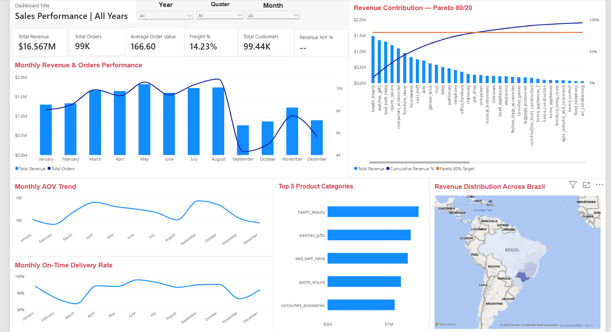
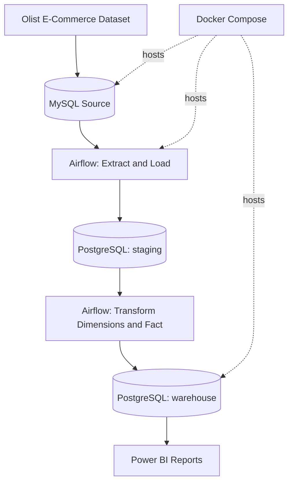

# End-to-End E-Commerce Data Engineering Pipeline

**Apache Airflow · Python · Docker · MySQL · PostgreSQL · Power BI**

A hands-on data engineering project that turns raw Brazilian e-commerce data into an analytics-ready dimensional model and an interactive business intelligence dashboard. The project covers data ingestion, orchestration, transformation, warehouse modeling, data validation, and business reporting.

> **Project background:** This repository was developed as a learning and portfolio project using external tutorials/open-source implementations as references. See [References & Acknowledgments](#references--acknowledgments) for source attribution and details about the work performed in this implementation.

## Dashboard Preview



*Power BI report showing revenue, order volume, average order value, monthly trends, category contribution (Pareto analysis), on-time delivery, and sales distribution across Brazil. Dashboard figures depend on the report's active filters and measures.*

## Project Goals

- Build an end-to-end pipeline from an operational data source to an analytics-ready warehouse.
- Orchestrate extraction and dimensional transformations using Apache Airflow.
- Model e-commerce data for analysis with fact and dimension tables.
- Validate data integrity and identify unresolved dimension mappings.
- Connect the warehouse to Power BI to explore sales, customers, categories, and delivery performance.

## Technology Stack

| Layer | Technology | Purpose |
| --- | --- | --- |
| Data source | MySQL 8 | Store imported e-commerce source data |
| Workflow orchestration | Apache Airflow 2.9.2 | Schedule and coordinate ETL tasks |
| Data processing | Python, pandas, SQL | Extract, clean, transform, and load data |
| Data warehouse | PostgreSQL | Staging schemas and dimensional analytics tables |
| Runtime | Docker Compose | Run the local multi-service environment |
| Business intelligence | Microsoft Power BI, DAX | Data modeling, KPIs, and interactive reporting |

## High-Level Architecture



## ETL Workflow

The Airflow DAG is named **`e_commerce_dw_etl`**. Its implementation separates source ingestion from warehouse transformations.

1. **Extract & load to staging:** Read source data from MySQL and load staging tables in PostgreSQL.
2. **Transform dimensions:** Clean and prepare customers, products, sellers, geolocation, dates, and payment information.
3. **Build the fact table:** Assemble order-level analytical records and connect them to dimension keys.
4. **Validate output:** Check row counts, date relationships, missing lookups, and key consistency.
5. **Analyze:** Refresh the Power BI semantic model/report using the PostgreSQL warehouse.

> The exact Airflow execution order and dependencies are defined by the Python DAG files. This overview summarizes the intended flow.

## Data Warehouse Model

The project uses a dimensional warehouse with the following logical tables:

| Table | Role |
| --- | --- |
| `warehouse.fact_orders` | Order-related measures and links to dimensions |
| `warehouse.dim_customers` | Customer attributes |
| `warehouse.dim_products` | Product attributes and categories |
| `warehouse.dim_sellers` | Seller attributes |
| `warehouse.dim_geolocation` | Geographic lookup information |
| `warehouse.dim_dates` | Calendar/date attributes |
| `warehouse.dim_payments` | Payment type and installment attributes |

The date model uses an integer date key in `YYYYMMDD` format (for example, `20170913`) and a corresponding full date in the date dimension. This supports the relationship `dim_dates.date_key` → `fact_orders.order_date_key` in Power BI.

**Modeling note:** Confirm the grain of `fact_orders` and the join cardinality of payment/order-item data before aggregating sales: source orders can have multiple items and payment records, and joining them without care can double-count measures.

## Data Quality & Validation

During development, warehouse checks included:

- **118,434** records in `fact_orders` at the time of the recorded validation run.
- **317** rows with an unresolved geolocation mapping (`geolocation_key = -1`).
- **3** rows with an unresolved payment mapping (`payment_key = -1`).
- **0** orphan date-key matches after aligning date key types and values.

These are **development validation results**, not automated pass/fail guarantees or current production metrics. Re-run the checks after loading or transforming data, and investigate unresolved dimension mappings before relying on the output for high-stakes reporting.

## Analytics Dashboard

The Power BI report includes:

- **Sales Overview:** Total Revenue, Total Orders, Average Order Value, Total Customers, Freight %, and Revenue YoY.
- **Monthly Performance:** Revenue and order trends, average order value, and on-time delivery performance.
- **Category Analysis:** Top product categories and cumulative revenue contribution (Pareto 80/20).
- **Geographical Analysis:** Revenue distribution by Brazilian state.
- **Interactive Filters:** Year, quarter, and month slicers.


**Interpretation notes:** Year-over-year measures require a meaningful comparison period; validate time-intelligence filter context before using a YoY KPI. Ensure geographical labels resolve all relevant Brazilian state codes, not only a small subset. Validate revenue and order measures against the source data and the fact-table grain.

## Technical Challenges & Lessons Learned

| Challenge | Approach taken |
| --- | --- |
| MySQL data import blocked by `LOCAL INFILE` configuration | Enabled the required local import capability and reloaded the source files |
| Airflow operator import mismatch | Adjusted imports to match the installed Airflow version |
| Date-table relationship issues in Power BI | Aligned the warehouse date keys to integer `YYYYMMDD` format |
| Missing dimension lookups | Ran SQL checks for unresolved geolocation and payment keys |
| Power BI relationship discovery | Reviewed explicit key mappings rather than relying solely on automatic relationship detection |

## Repository Structure

```text
Built-Airflow-for-E-commerce/
├── config/
├── dags/
│   ├── e_commerce_dw_dag.py
│   ├── extract_data.py
│   ├── transform_dim_customers.py
│   ├── transform_dim_dates.py
│   ├── transform_dim_geolocation.py
│   ├── transform_dim_payments.py
│   ├── transform_dim_products.py
│   ├── transform_dim_sellers.py
│   └── transform_fact_orders.py
├── dataset/
├── load_dataset_into_mysql/
│   ├── olist.sql
│   └── load_data.sql
├── plugins/
│   ├── mysql_operator.py
│   ├── postgresql_operator.py
│   └── support_processing.py
├── assets/
│   └── dashboard-overview.png
├── .env.example               # Create from your actual configuration keys
├── .gitignore                 # Exclude credentials and generated data
├── docker-compose.yaml
├── Dockerfile
├── requirements.txt
└── README.md
```

*Some supporting/local files are intentionally omitted from this tree. The `.env.example` file is recommended and should contain placeholder values only.*

## Running Locally

### Prerequisites

- Docker Desktop and Docker Compose
- Git
- Python (for optional local development)
- Power BI Desktop (for report exploration)

### 1. Clone the repository

```bash
git clone https://github.com/<YOUR_USERNAME>/<YOUR_REPOSITORY>.git
cd <YOUR_REPOSITORY>
```

### 2. Configure environment variables

Create a local `.env` file using the environment variable names expected by `docker-compose.yaml` and the pipeline's database connections. **Never commit real passwords, credentials, or secret keys.** Add a sanitized `.env.example` once those names have been checked against the current configuration.

### 3. Start the services

```bash
docker compose up -d --build
```

Open the Airflow web interface at **http://localhost:8080** if the project's Docker port mapping has not been changed.

### 4. Load the source dataset

Prepare the Olist dataset and run the project's SQL import scripts in `load_dataset_into_mysql/` against the MySQL service. Check import paths, database names, and `LOCAL INFILE` settings for the local environment.

### 5. Run the pipeline

In Airflow, locate **`e_commerce_dw_etl`**, verify that MySQL and PostgreSQL connections are configured, then trigger the DAG. Review task logs and table counts after the run.

### 6. Connect Power BI

Connect to the PostgreSQL warehouse using the credentials and exposed port configured in Docker Compose. In the development setup, PostgreSQL's warehouse service used host port **5433**; verify this in your local `docker-compose.yaml`. Load the relevant `warehouse` tables and set/verify relationships before refreshing the report.

> **Setup status:** This section is a high-level reproducibility guide based on the development environment. Connection names, environment variable keys, seed commands, credentials, and volume paths must be verified against the published repository before calling the setup fully turnkey.

## Roadmap

- [ ] Add automated data quality checks and unit tests.
- [ ] Export and document the warehouse entity relationship diagram (ERD).
- [ ] Add clearer data dictionary and metric definitions.
- [ ] Document the complete clean-install and seed-data commands.
- [ ] Add pipeline monitoring / failure alerting.
- [ ] Include a `.pbix` report or a public demo if sharing permissions allow.

## References & Acknowledgments

- **Source dataset:** [Brazilian E-Commerce Public Dataset by Olist](https://www.kaggle.com/datasets/olistbr/brazilian-ecommerce).
- **Reference project / tutorial:** **[ADD ORIGINAL AUTHOR AND REPOSITORY/TUTORIAL LINK HERE BEFORE MAKING THIS REPOSITORY PUBLIC]**.

This project was built for learning and portfolio demonstration. Parts of the pipeline design and/or implementation were informed by external learning materials; the reference above should identify the original source accurately. Respect any applicable upstream copyright notices and license requirements. The sections on debugging, data validation, warehouse date-key adjustments, and dashboarding describe work undertaken during this implementation.

## License

**Not specified yet.** Review upstream code and dataset licenses before selecting a repository license or redistributing source files/data.
